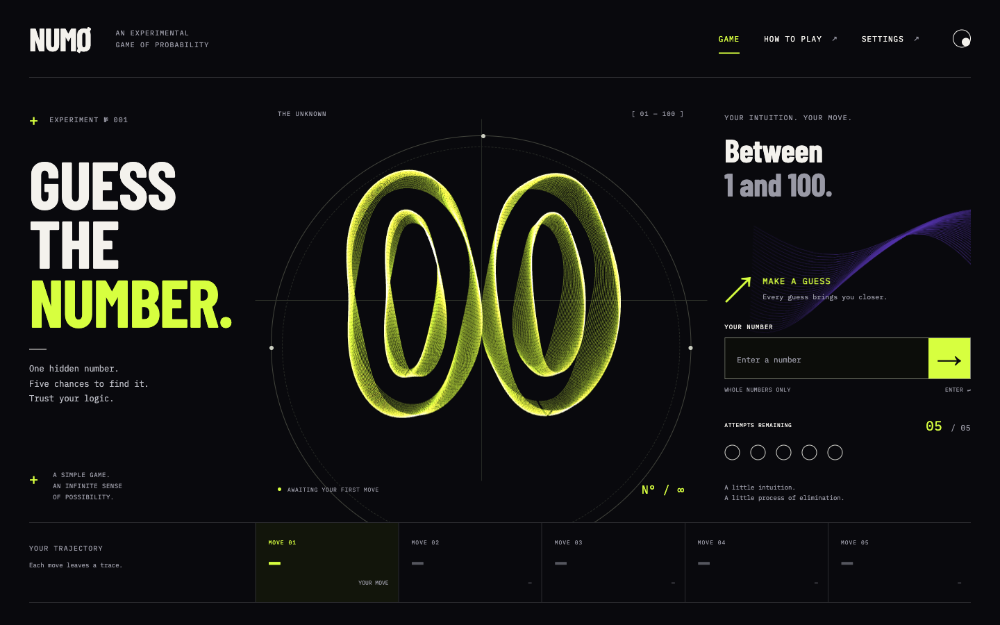
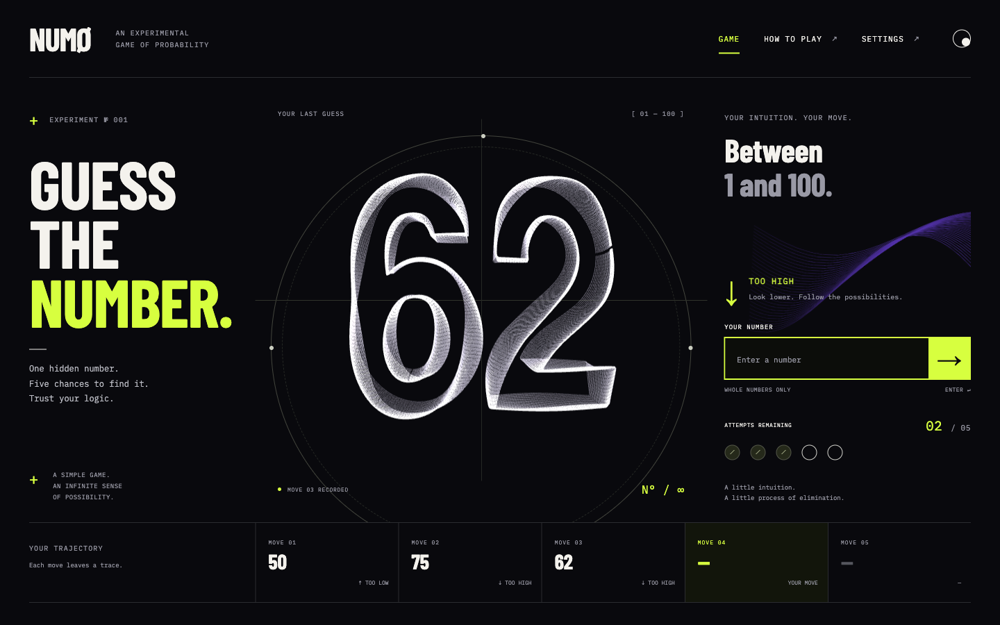
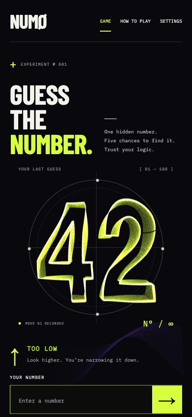
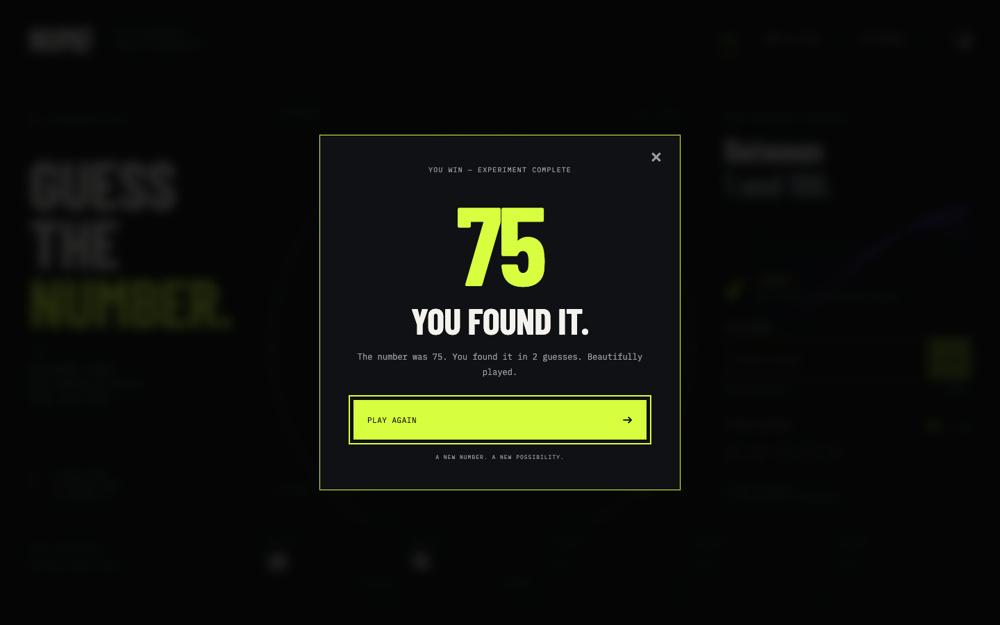
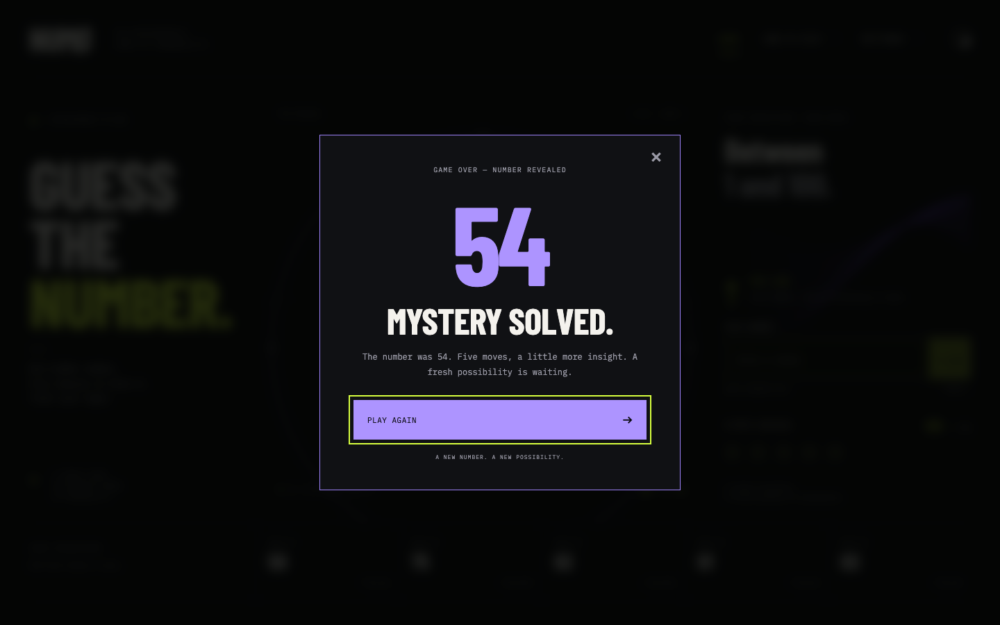
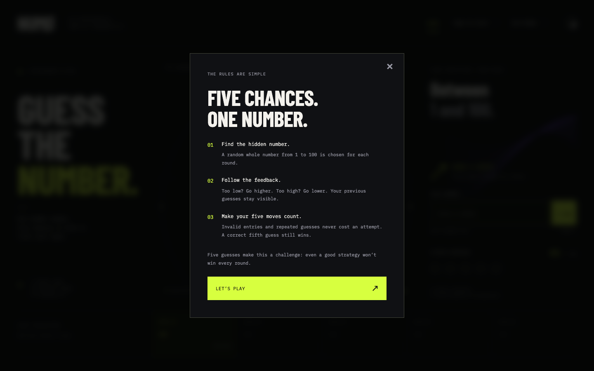

# NUMØ

An experimental game of probability. Find a hidden integer from 1–100 in five valid guesses. Invalid and repeated guesses never consume an attempt.

## Screenshots

| Mid-game | Mobile |
| --- | --- |
|  |  |

| Win | Loss |
| --- | --- |
|  |  |

## Run locally

Open `dist/index.html` with VS Code Live Server. No build, backend, account, or API key is required. The downloadable source ZIP places `index.html` directly inside the `numo/` folder; open that file with Live Server.

Use an HTTP server rather than double-clicking the HTML: browser ES modules and the font fetch need HTTP. An alternative from the Site checkout is `python3 -m http.server 5500 --directory dist`, then open `http://localhost:5500`.

## Files and responsibilities

- `index.html`: semantic layout, form, navigation, and native accessible dialogs.
- `css/styles.css`: design tokens, typography, desktop/mobile layout, interaction states, and reduced-motion styles.
- `js/game.js`: pure game state and validation. The secret is a private field, only included in a snapshot after a win or loss. This is a casual client-side game, not an anti-cheat system.
- `js/main.js`: DOM rendering, input submission, history, dialogs, preferences, and progressive enhancement.
- `js/animations.js`: small text transitions and the decorative violet SVG wave.
- `js/three-scene.js`: Three.js scene, contour sampling, number geometry, morphing, resizing, and WebGL lifecycle.
- `js/shaders.js`: commented GLSL vertex/fragment shaders. Three.js is a JavaScript library; its scene code is separated by responsibility, not a separate programming language.
- `vendor/`: local Three.js r180 ES modules and FontLoader. Their MIT license is included. FontLoader's import is changed to the local module.
- `assets/fonts/`: local Barlow Condensed, IBM Plex Mono, and Three.js Helvetiker bold font data. License files accompany the fonts.
- `tests/`: Node tests for game rules and glyph contours.
- `docs/screenshots/`: README screenshots captured from the running game in Chromium.

## How the living numbers work

1. Helvetiker font data generates closed outer contours and holes for each character.
2. The renderer samples those paths by arc length. Every value, including `100`, receives an equal-sized vertex buffer.
3. Thirty-four layers of those contours form a dimensional ribbon sculpture. Short line segments preserve gaps between disconnected contours.
4. A GLSL vertex shader interpolates current and target positions over 1,050 milliseconds. Smooth spatial sine fields create coherent organic movement. These are intentionally lightweight procedural waves, not Perlin/simplex noise.
5. If another guess arrives mid-transition, the current interpolated geometry becomes the next starting shape.
6. High/low/win/loss states change the color and response. A win adds a temporary expansion; a loss reveals the answer in violet.

Game state changes immediately. Animation completion never controls whether a guess is accepted or a round is won.

## Interaction and accessibility

Enter and the arrow button both submit the same form. The UI rejects empty input, non-digits, decimals, signs, out-of-range values, and duplicates. Surrounding whitespace is trimmed. Leading zeroes are allowed and compared numerically.

Native `<dialog>` elements trap focus and make the background inert. Escape, Close, and Play Again all restart a completed round. Desktop focus returns to the input; mobile returns to the Game control to avoid reopening the virtual keyboard automatically. Feedback is announced through a live region, while the decorative canvas is hidden from assistive technology.

System reduced-motion preferences always override the animation setting. Pause Motion stops the render loop; changing a number while paused renders its final shape immediately. Hidden tabs stop rendering. If Three.js, WebGL, or font loading fails, the game remains playable with a plain typographic number. Preferences are stored locally when storage is available. There is no tracking or analytics.

## Validation

Run `npm test` from the project root (Node 20+). No npm installation is necessary for these tests. Tests cover initial state, range boundaries, invalid/duplicate inputs, ordered high/low feedback, first/fifth-guess wins, five-miss loss, blocked post-game guesses, reset, repeated secret numbers, snapshot independence, and finite font contours for all values 00–100.

DOM integration checks also passed for validation, feedback, history, win/loss dialogs, reset controls, settings persistence, and the WebGL fallback. Those checks use simulated DOM/dialog behavior, not a browser.

Browser automation was unavailable in the build environment. A real-browser visual, keyboard, WebGL, and mobile pass remains necessary. Suggested checks:

- Submit via Enter and button. Confirm visible feedback and one consumed attempt.
- Enter blank, letters, `3.5`, `0`, `101`, and a repeated number. Confirm no consumed attempt.
- Finish a losing round and close the result using each control and Escape. Confirm five attempts and empty history.
- Navigate every control and dialog by keyboard; inspect focus visibility and announcements.
- Use narrow mobile and desktop widths. Confirm there is no horizontal scrolling or obscured form.
- Enable reduced motion before loading and while playing. Confirm the scene stays still.
- Pause motion, change numbers, hide/restore the tab, and disable WebGL. Confirm gameplay remains usable.

## Design and scope

Based on the supplied NUMØ design and specification: near-black, chartreuse, ultraviolet, oversized typography, an orbital number sculpture, input controls, five attempts, and an ordered move history. The reference's five small screens are state illustrations, so the app expresses them as live gameplay and result dialogs rather than showing static thumbnails.

No sound, leaderboard, accounts, or multiplayer are included. Three.js is the explicitly requested dependency and supersedes the original specification's approval requirement for adding a graphics library.
